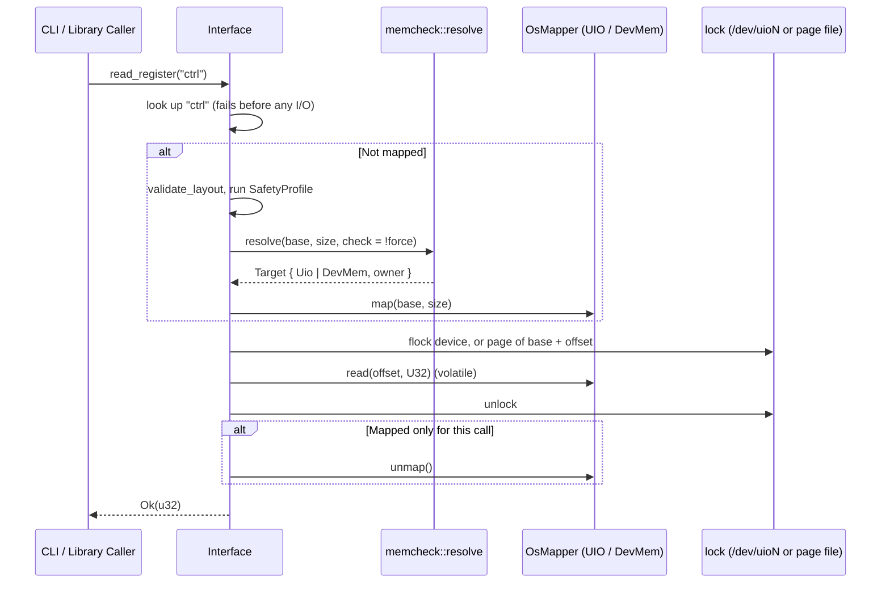

# 1. Architecture & Execution Flow

## Module Layout

Each module has one job; only `mmio.rs` contains `unsafe` memory access.

```text
src/
├── lib.rs         # Public exports; read_register_at / write_register_at
├── main.rs        # CLI: argument parsing, --validate, output
├── error.rs       # MmregError: [E_*] codes and messages
├── interface.rs   # Interface: layout checks, map/unmap lifecycle, locked register access
├── register.rs    # Register and SubRegister (bitfield) definitions
├── memregs.rs     # MemoryMapper trait, MapperType, OsMapper (/dev/mem and UIO windows)
├── mmio.rs        # Page size, device open, flock, mmap/munmap (Mapping), volatile 8–64-bit access
├── memcheck.rs    # Blueprint lookup (UIO, Device Tree, /proc/iomem), pre-flight, runtime PM guard
├── lock.rs        # Lock protocol: flock on /dev/uioN, or per-page lock files for /dev/mem
├── validation.rs  # SafetyProfile / ValidationCheck; JSON parsing behind the `profile` feature
└── parse.rs       # Integer parsing for CLI, profiles and sysfs
```

Dependencies: `libc` (mmap, sysconf, flock) is the only dependency. Locking uses `flock(2)`
through `mmio.rs`, the only module with `unsafe`.

---

## Execution Flow



---

## Concurrency & Lifecycle

1. **Lock protocol** (`lock.rs`, stable since 1.0.0 so other programs can follow it): every access,
   and every `write_subregister` read-modify-write, holds an exclusive `flock`:
   - **UIO:** on an open file of `/dev/uioN` (opened read-only at `map()`, kept until `unmap()`).
     A C program that takes `flock(LOCK_EX)` on its own `/dev/uioN` descriptor excludes and is
     excluded by mmreg.
   - **`/dev/mem` and custom mappers:** on `<lock dir>/<page base>-<page end>.lock` for the page
     holding the register. An aligned register never spans two pages, so one lock per access
     suffices and no lock ordering is needed.

   `flock` belongs to an open file, so two `Interface`s in one process exclude each other too.
   Locks are not held between calls, so unrelated `Interface`s never deadlock.
2. **Lock files are never deleted**: unlinking a lock file while another process waits on it lets
   two processes lock different inodes of "the same" file. Closing the file (or process exit)
   releases the lock. Lock files are opened read-only, which `flock` allows whoever created them;
   the plain open is tried before `O_CREAT` because `fs.protected_regular` stops even root from
   `O_CREAT`-opening another user's file in a sticky directory.
3. **Lock directory**: `/run/lock/mmreg` when `/run/lock` exists, else `/tmp/mmreg-lock`, created
   `1777` so root and non-root always use the same directory.
4. **RAII**: `Mapping` unmaps on drop and `RuntimePmGuard` restores `power/control` on drop;
   `Interface::drop` calls `unmap()`, which releases the mapping before the PM guard.
5. **Batch vs. single-shot**: accesses on an unmapped `Interface` map and unmap around themselves.
   After `map()`, they reuse the mapping, and the layout, profile and pre-flight checks are not
   repeated.
