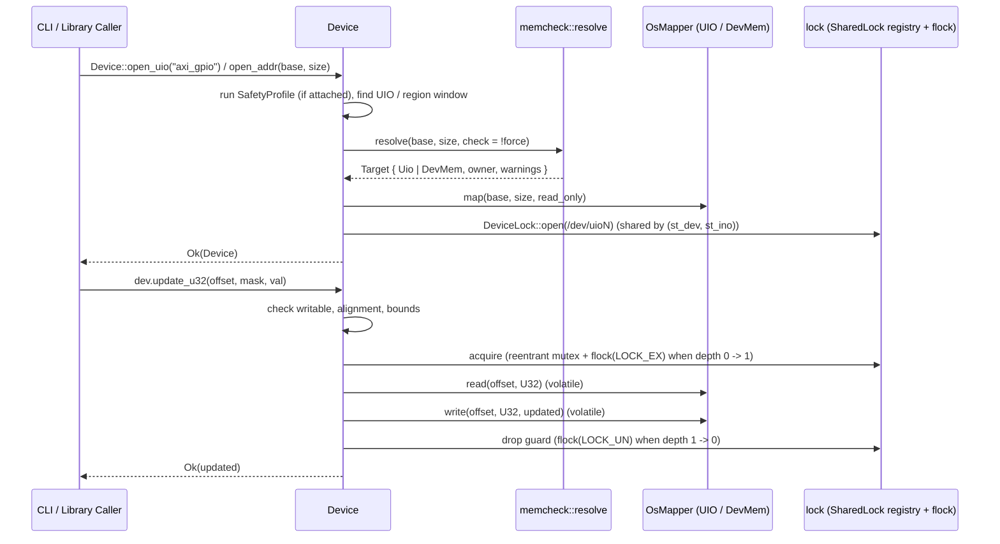

# 1. Architecture & Execution Flow

## Module Layout

Each module has one job; only `mmio.rs` contains `unsafe` memory and OS calls.

```text
src/
├── lib.rs         # Public exports; read_register_at / write_register_at
├── main.rs        # CLI: argument parsing (--width, <uio-name> <offset>, --version), output
├── device.rs      # Device, DeviceBuilder, uio::find: &self 8–64-bit access, sequence lock, UIO IRQs
├── interface.rs   # Interface: named registers/subregisters layered on top of Device
├── register.rs    # Register and SubRegister (bitfield) definitions
├── error.rs       # MmregError: [E_*] codes and remediation messages
├── memregs.rs     # MemoryMapper trait, Width, MapperType, OsMapper (/dev/mem and UIO windows)
├── mmio.rs        # Page size, device open, flock, UIO poll/read/write, mmap/munmap, volatile access
├── memcheck.rs    # UIO name/region lookup, Blueprint lookup, pre-flight, runtime PM guard, warnings
├── lock.rs        # Per-process (st_dev, st_ino) lock registry, reentrant LockGuard, flock(2)
├── validation.rs  # SafetyProfile / ValidationCheck; JSON parsing behind the `profile` feature
└── parse.rs       # Zero-allocation integer parsing for CLI, profiles and sysfs
```

Dependencies: `libc` (`mmap`, `sysconf`, `flock`, `poll`, `read`, `write`) is the only dependency.
All `unsafe` code is isolated in `mmio.rs`. The library never writes to `stderr`; non-fatal
pre-flight warnings are collected in `Target.warnings` and exposed via `Device::warnings()` and
`Interface::warnings()`.

---

## Execution Flow



---

## Concurrency & Lifecycle

1. **Inter-process lock protocol** (`lock.rs`, stable since 1.0.0 so other programs can follow it):
   every access, every `update_u32` / `write_subregister` read-modify-write, and every explicit
   `dev.lock()` sequence guard holds an exclusive `flock`:
   - **UIO:** on an open file of `/dev/uioN` (opened read-only at `Device` open, kept until drop).
     A C program that takes `flock(LOCK_EX)` on its own `/dev/uioN` descriptor excludes and is
     excluded by mmreg.
   - **`/dev/mem` and custom mappers:** on `<lock dir>/<page base>-<page end>.lock` for the page
     holding the register. An aligned register never spans two pages, so a single-register access
     takes the lock of its own physical page, the same file the CLI and any other program lock;
     an explicit `dev.lock()` sequence guard acquires the page locks of every page covered by the
     window in ascending address order and releases them in reverse order on drop, preventing
     deadlocks across overlapping windows. A guard holds one open lock file per page, so it is
     refused (`[E_LOCK_RANGE]`) for windows over `Device::MAX_SEQUENCE_PAGES` (64) pages. Lock
     files are never shared between pages (no striping): a lock is only meaningful if every
     participant derives the same file from the physical address.
2. **Intra-process `(st_dev, st_ino)` registry & reentrant sequence guard**:
   `flock(2)` belongs to an open file description (`struct file`), so two independent `open()` calls
   in the same process would deadlock on each other if acquired on the same thread, while two
   threads sharing one descriptor would not exclude each other without a mutex. `lock.rs` maintains
   a process-wide registry keyed by `(st_dev, st_ino)` (holding `Weak<SharedLock>`):
   - Every `Device` handle in the process referring to the same `/dev/uioN` or page lock file shares
     one `Arc<SharedLock>` (one open file descriptor + `Mutex<OwnerState>` + `Condvar`).
   - When the first guard on a thread is acquired (`depth: 0 -> 1`), it waits until no other thread
     in the process owns the lock, then takes `flock(LOCK_EX)` on the shared descriptor.
   - Nested acquisitions on the holding thread (`let _g = dev.lock()?;` followed by `dev.read_u32`,
     `dev.update_u32`, or another `dev.lock()`) increment `depth` without another syscall.
   - When the outermost guard on that thread is dropped (`depth: 1 -> 0`), `flock(LOCK_UN)` is
     called and one waiting thread is notified.
3. **Lock files are never deleted**: unlinking a lock file while another process waits on it lets
   two processes lock different inodes of "the same" file. Closing the file (or process exit)
   releases the lock. Lock files are opened read-only, which `flock` allows whoever created them;
   the plain open is tried before `O_CREAT` because `fs.protected_regular` stops even root from
   `O_CREAT`-opening another user's file in a sticky directory.
4. **Lock directory**: `/run/lock/mmreg` when `/run/lock` exists, else `/tmp/mmreg-lock`, created
   `1777` so root and non-root always use the same directory.
5. **RAII**: `Mapping` unmaps on drop and `RuntimePmGuard` restores `power/control` on drop;
   `Device::drop` unmaps its window before releasing the `DeviceLock` and `RuntimePmGuard`.
