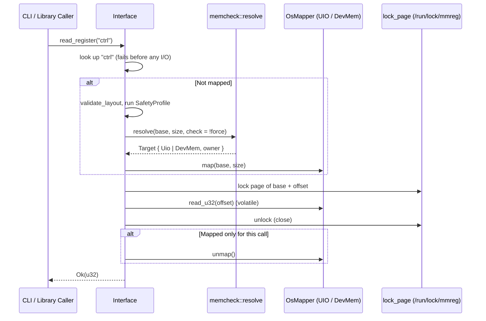

# 1. Architecture & Execution Flow

## Module Layout

Each module has one job; only `mmio.rs` contains `unsafe` memory access.

```text
src/
├── lib.rs         # Public exports; read_register_at / write_register_at
├── main.rs        # CLI: argument parsing, --validate, output
├── error.rs       # MmregError: [E_*] codes and messages
├── interface.rs   # Interface: layout checks, map/unmap lifecycle, locked register access
├── register.rs    # Register and SubRegister (bitfield) definitions
├── memregs.rs     # MemoryMapper trait, MapperType, OsMapper (/dev/mem and UIO windows)
├── mmio.rs        # Page size, device open, mmap/munmap (Mapping), volatile 32-bit access
├── memcheck.rs    # Blueprint lookup (UIO, Device Tree, /proc/iomem), pre-flight, runtime PM guard
├── lock.rs        # Per-page inter-process lock files
├── validation.rs  # SafetyProfile / ValidationCheck; TOML parsing behind the `profile` feature
└── parse.rs       # Integer parsing for CLI, profiles and sysfs
```

Dependencies: `libc` (mmap, sysconf); `toml` and `serde` only with the `profile` feature. Locking
uses `std::fs::File::lock`.

---

## Execution Flow



---

## Concurrency & Lifecycle

1. **Per-page locks** (`lock.rs`): every access, and every `write_subregister` read-modify-write,
   holds an exclusive `flock` on `<lock dir>/<page base>-<page end>.lock` for the page holding the
   register. An aligned 32-bit register never spans two pages, so one lock per access suffices and
   no lock ordering is needed. Locks are not held between calls, so unrelated `Interface`s (in one
   process or many) never deadlock and only users of the same page wait for each other.
2. **Lock files are never deleted**: unlinking a lock file while another process waits on it lets
   two processes lock different inodes of "the same" file. Closing the file (or process exit)
   releases the lock. Lock files are opened read-only, which `flock` allows whoever created them;
   the plain open is tried before `O_CREAT` because `fs.protected_regular` stops even root from
   `O_CREAT`-opening another user's file in a sticky directory.
3. **Lock directory**: `/run/lock/mmreg`, else `/tmp/mmreg-lock`, created `1777`.
4. **RAII**: `Mapping` unmaps on drop and `RuntimePmGuard` restores `power/control` on drop;
   `Interface::drop` calls `unmap()`, which releases the mapping before the PM guard.
5. **Batch vs. single-shot**: accesses on an unmapped `Interface` map and unmap around themselves.
   After `map()`, they reuse the mapping, and the layout, profile and pre-flight checks are not
   repeated.
